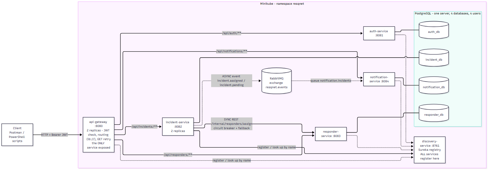

# ResQNet Lite

**A microservices-based emergency dispatch platform** built for a college Microservices Lab.
A user reports an emergency (medical, fire, police). The system saves it, asks a separate service for a free
responder of the right type, assigns one, and records a notification. If the responder service is down, the
incident is **still accepted** as `PENDING` and can be dispatched later.

Everything runs as pods on **Minikube** (Kubernetes) behind a single **API Gateway** that checks a **JWT** on every request.
This is a simulation: no real emergency services or personal data are involved. Total cost: Rs 0 (all free, open-source tools).

---

## 1. What it demonstrates (the lab rubric)

The lab slide lists eight criteria. Honest status of each:

| Criterion | What proves it | Status |
|---|---|---|
| **Deployed** | All services run as pods on Minikube (`kubectl -n resqnet get pods`), reachable from a public link | **Done (tunnel).** 10 pods on Minikube. `scripts/start-public-url.ps1` opens a temporary public HTTPS link (free Cloudflare quick tunnel) to the gateway; the full smoke test (37 checks) passed through that public link. It is a tunnel to the laptop, **not cloud hosting**: the link changes each time and works only while the laptop is on. |
| **Handles traffic** | `scripts/load-test.ps1`: many users at once; two `incident-service` pods share the requests (round-robin through the gateway) | **Done.** `scripts/load-test.ps1`: 20 simultaneous users, 1,500 requests, all HTTP 200, about 130-150 requests/second, average 134-153 ms, p95 about 270-295 ms, and `/api/incidents` shared exactly 50% / 50% by the two `incident-service` pods (two clean-cluster runs). |
| **Database** | One PostgreSQL server, **four databases, four users**; a user cannot even connect to another service's database | Done and verified |
| **Cross-service communication** | **Synchronous:** incident-service calls responder-service (REST). **Asynchronous:** incident-service publishes events to RabbitMQ, notification-service consumes them | Done and verified |
| **Resilience** | Scale `responder-service` to 0: incidents are still accepted (`PENDING`), login and notifications still work | Done and verified in the cluster |
| **Service discovery and gateway** | **Eureka** registry + one **Spring Cloud Gateway** entry point routing by service name (`lb://...`) | Done and verified in the cluster |
| **Security** | JWT checked **at the gateway**; 401 without a valid token, 403 for a USER on admin endpoints | Done and verified (19 checks) |
| **Testing** | JUnit tests in every service | **Done.** 51 automated JUnit tests pass (`scripts/run-unit-tests.ps1`), plus scripts and Postman; every result is in [`docs/TEST_REPORT.md`](docs/TEST_REPORT.md) (application tests and script/document tests kept separate). |

---

## 2. Architecture

```text
                    Postman / PowerShell scripts
                               |
                               v
                  +-------------------------+
                  |       api-gateway       | :8080  (only thing exposed)
                  |  JWT check, routing,    |
                  |  lb:// via Eureka       |
                  +------------+------------+
                               |  adds X-User-Id / X-User-Name / X-User-Role
        +----------------+-----+----------+-------------------+
        v                v                 v                   v
 +-------------+  +----------------+ +-----------------+ +--------------------+
 | auth-service|  | incident-      | | responder-      | | notification-      |
 |   :8081     |  | service :8082  |>| service :8083   | | service :8084      |
 |   auth_db   |  |  incident_db   | |  responder_db   | |  notification_db   |
 +-------------+  +-------+--------+ +-----------------+ +---------^----------+
                          | sync REST (circuit breaker)           |
                          +------> RabbitMQ  exchange "resqnet.events" ---+
                                   (async event incident.assigned / incident.pending)

   discovery-service (Eureka) :8761  <-- every service registers here, gateway/incident look others up by name
   PostgreSQL (1 server, 4 databases, 4 users)        RabbitMQ (1 broker)
   --------------------- all in Minikube namespace "resqnet" ---------------------
```

| Service | Port | Database | Job |
|---|---|---|---|
| `api-gateway` (2 replicas) | 8080 | none | Single entry point. Verifies the JWT, strips forged identity headers, routes `/api/**` to services by name. Never routes `/internal/**`. |
| `auth-service` | 8081 | `auth_db` | Register, login (BCrypt), issues HS256 JWTs, seeds a demo admin |
| `incident-service` | 8082 | `incident_db` | Incident lifecycle; calls responder-service; circuit breaker + fallback; publishes events |
| `responder-service` | 8083 | `responder_db` | Responder catalogue; **atomic** assignment and release |
| `notification-service` | 8084 | `notification_db` | Consumes events, stores notifications, de-duplicates by `eventId` |
| `discovery-service` | 8761 | none | Eureka service registry |



### Request flows

**Report an incident (happy path)**
1. Client sends `POST /api/incidents` with `Authorization: Bearer <jwt>` to the gateway.
2. Gateway verifies the token, removes any client `X-User-*` headers, adds trusted ones, and routes to a running `incident-service`.
3. incident-service saves the incident (`REPORTED`) and commits, **then** calls responder-service `POST /internal/responders/assign` (never inside a database transaction).
4. responder-service locks one free responder row (`FOR UPDATE SKIP LOCKED`) and marks it `BUSY`.
5. incident-service sets `ASSIGNED`, publishes `incident.assigned` to RabbitMQ and returns `201`.
6. notification-service receives the event and stores a notification (ignoring duplicates).

**Responder service down (resilience)**: the call fails fast (1 s connect / 2 s read timeout, then the circuit breaker opens), the **fallback** marks the incident `PENDING`, publishes `incident.pending`, and still returns `201`. Login, listing incidents and notifications are unaffected. When the responder service returns, an admin calls `POST /api/incidents/{id}/dispatch`.

---

## 3. Three ideas worth knowing for the viva

| Idea | Where | In one sentence |
|---|---|---|
| **Atomic assignment** | `responder-service` : `ResponderRepository.lockFirstAvailable`, `ResponderService.assign`, `schema.sql` | One SQL query locks the chosen responder row (`FOR UPDATE SKIP LOCKED`), so two simultaneous incidents can never get the same responder; a unique index is the last line of defence. |
| **Circuit breaker + fallback** | `incident-service` : `client/ResponderClient`, `application.yml` (`resilience4j`) | After repeated failures the breaker opens and calls fail instantly; the fallback turns "no answer" into a `PENDING` incident. A 409 "no responder free" is a normal answer, not a failure. |
| **JWT filter at the gateway** | `api-gateway` : `security/JwtAuthenticationFilter` | A `GlobalFilter` with highest priority rejects bad tokens with 401 before any service is called, and replaces identity headers with verified ones. |

Other patterns used: gateway retry of idempotent GETs, idempotent consumer (unique `event_id`), database-per-service, `X-Served-By` header to show which pod answered, Kubernetes init containers (wait for Postgres/RabbitMQ), startup/liveness/readiness probes.

---

## 4. Technology

Java 17 · Spring Boot 3.5 · Spring Cloud 2025.0 (Gateway, Netflix Eureka, LoadBalancer) · Spring Data JPA · PostgreSQL 16 ·
RabbitMQ 3 (Spring AMQP) · Resilience4j · jjwt 0.12 · Maven · Docker · Kubernetes (Minikube) · JUnit 5, Mockito, Testcontainers · PowerShell scripts.

---

## 5. Repository layout

```text
api-gateway/  auth-service/  incident-service/  responder-service/  notification-service/  discovery-service/
                          each: pom.xml, Dockerfile, src/main/java/com/resqnet/<name>/..., src/test/...
k8s/                      Kubernetes manifests (namespace resqnet), applied in file-name order
db/init-databases.sh      creates the 4 databases and 4 users (also embedded in k8s/02-config.yaml)
docker-compose.yml        local Postgres (host port 5433) + RabbitMQ
scripts/                  deploy-minikube.ps1, smoke-test.ps1, demo-resilience.ps1, demo-failover.ps1, load-test.ps1, verify-references.ps1,`n                          generate-references.ps1, rehearsal.ps1 (all of them from a clean cluster), lib.ps1 (shared helpers)`npostman/                   ResQNet-Lite.postman_collection.json (28 requests, all with status-code tests)
docs/                     PRD, Architecture, API_CONTRACT, schema, AUTHENTICATION, rules, ui, tracker,`n                          viva/CODE_REFERENCES.md (generated file:line references), evidence/ (rehearsal logs)
Documents/                original planning documents and prompts (kept as received)
AGENTS.md                 conventions for AI coding agents working in this repo
```

Inside each service the layers are `controller -> service -> repository`, plus `dto`, `model`, `config`, `exception` (and `client`, `messaging`, `security` where needed). Services share **no** code, entities or database.

---

## 6. Run it

### Prerequisites (Windows 11, PowerShell)
JDK 17 (build with JDK 17 even if another JDK is the default), Maven, Docker Desktop, kubectl, Minikube (docker driver), Git.

### A) On Minikube (the real deployment)

```powershell
minikube start --driver=docker --cpus=4 --memory=4096
.\scripts\deploy-minikube.ps1          # builds jars + images, loads them into Minikube, applies k8s/, waits for Ready
kubectl -n resqnet get pods            # every pod should be 1/1 Running
kubectl -n resqnet port-forward svc/api-gateway 8080:8080     # then use http://localhost:8080
```

The Minikube runtime here is containerd, so `minikube docker-env` does not work; the script uses `minikube image load` instead.
Handy extras:

```powershell
kubectl -n resqnet port-forward svc/discovery-service 8761:8761   # Eureka dashboard: http://localhost:8761
kubectl -n resqnet port-forward svc/rabbitmq 15672:15672          # RabbitMQ UI (user resqnet / rabbit-demo)
kubectl -n resqnet exec deploy/postgres -- psql -U postgres -c "\l"   # shows the 4 databases
kubectl delete ns resqnet                                         # wipe everything for a clean start
```

### C) A public link for the demo (temporary tunnel to the laptop)

```powershell
.\scripts\start-public-url.ps1            # prints https://<random-words>.trycloudflare.com ; Ctrl+C closes it
.\scripts\start-public-url.ps1 -Minutes 30
.\scripts\start-public-url.ps1 -Check     # opens the link, runs scripts\smoke-test.ps1 through it, closes it
```

It uses a free Cloudflare "quick tunnel" (`tools\cloudflared\cloudflared.exe`, official release, checksum and signature checked, not stored in Git). Be aware: **anyone with the link can use the system, including the demo admin login** (`admin` / `Admin@123`), so open it only for the demo and close it afterwards. The address is new every time. This is a tunnel to Minikube running on your laptop; the laptop must stay on and connected.
### B) Locally without Kubernetes

```powershell
docker compose up -d                   # Postgres on localhost:5433 + RabbitMQ on 5672
# Start discovery-service first, then each service with the local profile (demo values only), e.g.:
cd discovery-service; mvn spring-boot:run
cd ..\auth-service;   mvn spring-boot:run "-Dspring-boot.run.profiles=local"
# ... same for responder-service, incident-service, notification-service, api-gateway
```

Always use JDK 17 for builds (`$env:JAVA_HOME = "C:\Program Files\Eclipse Adoptium\jdk-17..."`).

---

## 7. Try it (5-minute demo)

Demo accounts: admin `admin` / `Admin@123` (seeded). Register your own user, e.g. `asha` / `Pass@1234`.

```powershell
$b = "http://localhost:8080"
# 1. No token -> 401 from the gateway
Invoke-WebRequest "$b/api/incidents" -UseBasicParsing        # (throws 401)
# 2. Register, login
Invoke-RestMethod -Method Post "$b/api/auth/register" -ContentType application/json -Body '{"username":"asha","password":"Pass@1234"}'
$t = (Invoke-RestMethod -Method Post "$b/api/auth/login" -ContentType application/json -Body '{"username":"asha","password":"Pass@1234"}').token
$h = @{ Authorization = "Bearer $t" }
# 3. Report an incident -> 201, ASSIGNED, ambulance named
Invoke-RestMethod -Method Post "$b/api/incidents" -Headers $h -ContentType application/json -Body '{"type":"MEDICAL","severity":"CRITICAL","description":"Person collapsed near library","locationText":"Main Library, Gate 2"}'
# 4. Asynchronous event -> notification appears
Invoke-RestMethod "$b/api/notifications" -Headers $h
```

Resilience demo:

```powershell
kubectl -n resqnet scale deploy/responder-service --replicas=0     # responder "crashes"
# report another incident -> 201 with status PENDING; GET /api/responders -> 503; login and notifications still work
kubectl -n resqnet scale deploy/responder-service --replicas=1     # it returns
# as admin: POST /api/incidents/{id}/dispatch  -> ASSIGNED
```

Load balancing demo:

```powershell
kubectl -n resqnet get pods -l app=incident-service              # two pods
.\scripts\load-test.ps1                                          # 20 users in parallel; shows which pod answered
```

### API at a glance (all via the gateway, prefix `/api`)

| Endpoint | Who |
|---|---|
| `POST /auth/register`, `POST /auth/login` | public |
| `GET /auth/me` | any logged-in user |
| `POST /incidents`, `GET /incidents`, `GET /incidents/{id}` | USER (own incidents) / ADMIN (all) |
| `POST /incidents/{id}/dispatch`, `POST /incidents/{id}/resolve` | ADMIN only |
| `GET /responders`, `GET /responders/{id}` | any logged-in user |
| `GET /notifications`, `PATCH /notifications/{id}/read` | own (ADMIN: all) |
| `GET /actuator/health` | public |

Full details, payloads and error codes: [`docs/API_CONTRACT.md`](docs/API_CONTRACT.md). Responses use one JSON error format (`timestamp, status, error, code, message, path, details`).

---

## 8. Security model

- Passwords are stored as **BCrypt** hashes; public registration always creates role `USER`.
- The **gateway is the only place a JWT is verified** (HS256 signature, issuer, expiry). Services read the verified identity from `X-User-*` headers and apply role rules; they never parse tokens.
- The gateway **removes client-sent `X-User-*` headers** (a forged `X-User-Role: ADMIN` is ignored).
- Only `api-gateway` is exposed (NodePort); every other Service is `ClusterIP`. `/internal/**` is never routed (404).
- **Demo secrets:** `k8s/01-secrets.yaml` and the `application-local.yml` files contain clearly labelled demo values for the lab. Never reuse them for anything real.

Known limits: no refresh tokens or revocation, no HTTPS inside the cluster, no rate limiting, symmetric JWT key shared by auth-service and gateway.

---

## 9. Testing

```powershell
cd <service>; mvn test        # use JDK 17; Docker must be running (Testcontainers starts a throw-away Postgres)
```

| Service | Tests | What they cover |
|---|---|---|
| auth-service | 5 | duplicate username 409, wrong password 401, registration always USER |
| api-gateway | 14 | missing / garbage / expired / wrong-secret / wrong-issuer tokens rejected, valid accepted, forged headers replaced; GET retried on a healthy copy, POST never retried |
| responder-service | 4 | 10 concurrent assignments for 3 ambulances give exactly 3 distinct responders (verified to fail if the row lock is removed); idempotent assign; release rules |
| incident-service | 19 | fallback to `PENDING` on 409 / connection refused / 3 s hang / HTTP 500, breaker opens, dispatch/resolve rules, access rules, events published |
| notification-service | 9 | duplicate `eventId` creates one notification (also with 8 simultaneous copies), malformed events rejected, templates, access rules |

Beyond unit tests, these were run against the real cluster: a 10-case security checklist (plus 9 extra checks), the resilience scenarios, pod-restart self-healing and persistence, RabbitMQ and notification outages, and the Eureka/load-balancing scenarios.

Load test: `scripts/load-test.ps1` (see section 7). **Result (two runs, each on a freshly deployed cluster, through `kubectl port-forward`):** 20 users x 25 rounds x 3 endpoints = 1,500 requests, **all HTTP 200**; 10.3 s / 146 requests/s and 11.8 s / 127 requests/s; latency avg 134 / 153 ms, p95 271 / 295 ms, max 498 / 506 ms; `/api/incidents` answered 250 + 250 by the two incident pods. Full logs: `docs/evidence/`. An earlier attempt failed (81 timeouts, pods restarted) while Windows itself was out of memory (29.7 of 32.7 GB committed, heavy paging, so the Docker VM was starved); the manifests now use a lighter JVM (serial GC, C1 compiler, small stacks, 768 Mi limit) and a more patient startup probe (450 s), and the lab laptop should have other heavy applications closed during the demo.

**Failover (measured):** `scripts/demo-failover.ps1` deletes one of the two incident-service pods while GET requests keep flowing. With the **old** gateway 9 of 32 requests failed (eight 503s and one request that hung for 30 s). With the **gateway retry** (failed GETs are retried on the other copy, 1 s connect timeout) all 114 of 114 requests returned HTTP 200 and the slowest took 1.08 s. POST requests are deliberately not retried automatically (a repeated "report incident" could create two incidents), so a POST sent in the same second can still fail once and should be repeated by the caller.

---

## 10. Documentation map

| File | Content |
|---|---|
| [`docs/PRD.md`](docs/PRD.md) | scope, user stories, acceptance criteria |
| [`docs/Architecture.md`](docs/Architecture.md) | services, flows, deployment, decisions |
| [`docs/API_CONTRACT.md`](docs/API_CONTRACT.md) | endpoints, payloads, status codes, events (highest authority) |
| [`docs/schema.md`](docs/schema.md) | tables, enums, state machines |
| [`docs/AUTHENTICATION.md`](docs/AUTHENTICATION.md) | JWT, gateway filter, role matrix, security checklist |
| [`docs/rules.md`](docs/rules.md) | coding / Kubernetes / git rules |
| [`docs/tracker.md`](docs/tracker.md) | live task list, decisions log, work log |
| [`docs/viva/VIVA_SCRIPT.md`](docs/viva/VIVA_SCRIPT.md) | viva script: introductions, demo narration, file walkthrough, flows, Docker/Kubernetes explained, 36 likely questions with answers |
| [`docs/viva/QUICK_REVISION.md`](docs/viva/QUICK_REVISION.md) | one-page revision sheet |
| [`docs/viva/STUDY_PLAN.md`](docs/viva/STUDY_PLAN.md) | 3-hour plan: big picture, IntelliJ code tour (12 stops), demo practice, questions out loud, "what if" drills |
| [`docs/FINAL_CHECKLIST.md`](docs/FINAL_CHECKLIST.md) | final deliverables and the eight lab criteria with evidence; owner actions |
| [`docs/viva/CODE_REFERENCES.md`](docs/viva/CODE_REFERENCES.md) | 43 generated file:line references, checked by `scripts/verify-references.ps1` |
| [`docs/demo/DEMO_SCRIPT.md`](docs/demo/DEMO_SCRIPT.md) | timed 5-minute demo (what to type, what happens, what to say) |
| [`docs/TEST_REPORT.md`](docs/TEST_REPORT.md) | all test results; Part A application, Part B scripts and documents, and a list of what was NOT independently verified |
| `docs/diagrams/` | six diagrams as PNG with Mermaid sources in `docs/diagrams/sources/` (architecture, report-incident sequence, fallback sequence, event flow, database ER, Minikube deployment) |
| `docs/evidence/` | raw logs: rehearsal runs, failover before/after, unit tests, documentation check |
| [`AGENTS.md`](AGENTS.md) | conventions for AI coding agents |

---

## 11. Project status and what is left

**Rehearsal result:** `scripts\rehearsal.ps1` deletes the namespace, deploys, and runs the smoke test (37 checks), the resilience demo (16 checks), the failover demo (7 checks), the Postman collection with newman (43 assertions), the load test and the code-reference check. It **passed twice in a row from a clean cluster**, and passed again after the gateway retry was added, now with the `demo-failover.ps1` step as well (8 steps, latest log `docs/evidence/rehearsal-run3.txt`); every pod ended with 0 restarts.

| Script | Purpose |
|---|---|
| `scripts/deploy-minikube.ps1` | build jars and images, load them into Minikube, apply `k8s/`, wait for Ready |
| `scripts/smoke-test.ps1` | health, security, register/login, incident, notification, roles, validation (PASS/FAIL per step, exit code) |
| `scripts/demo-resilience.ps1` | scale responder-service to 0 and back; the rest keeps answering |
| `scripts/demo-failover.ps1` | delete one of two incident-service pods under traffic; every GET must still return 200 |
| `scripts/load-test.ps1` | 20 parallel users; shows which pod answered |
| `scripts/verify-references.ps1` | checks every `file:line` reference in `docs/viva/` against the source |
| `scripts/start-public-url.ps1` | temporary public HTTPS link (Cloudflare quick tunnel) to the gateway on the laptop; `-Check` runs the smoke test through it |
| `scripts/run-unit-tests.ps1` | all 51 JUnit tests with a summary table |
| `scripts/verify-docs.ps1` | checks that every file, link, script option, class.method and Kubernetes name mentioned in the documents exists |
| `scripts/rehearsal.ps1` | everything above from a clean cluster, with a summary table |

Still to do (tracked in `docs/tracker.md`):
- the optional admin endpoints for responders (create, set OFFLINE) were not built
- a last full rehearsal on the evaluation machine (`.\scripts\rehearsal.ps1 -Rebuild`) and the owner's own check of the items listed under "NOT independently verified" in `docs/TEST_REPORT.md`