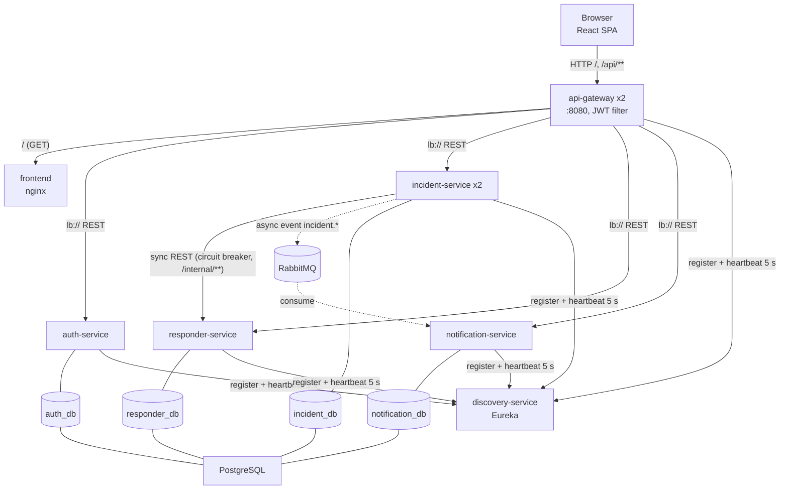

# Integration audit (Phase 1, 25 Nov 2026)

Result of reading the controllers, `application.yml` files, Kubernetes manifests, gateway code and the frontend before the operations command center was built. Everything here was read from the repository, not assumed.

## 1. Component dependency diagram

Solid arrows are synchronous REST, dotted arrows are asynchronous RabbitMQ events. discovery-service does not register with itself.

## 2. What exists today (verified in the code)

| Fact | Where |
|---|---|
| Public endpoints (14): auth 3, incidents 5, responders 2, notifications 2 | `*Controller.java`; `InternalResponderController` (assign, release) is not routed |
| Gateway routes `/api/auth`, `/incidents`, `/responders`, `/notifications` with `lb://`, GET retry; `/` to the frontend | `GatewayRoutes.java` |
| Every service and the gateway expose only `health,info` actuator endpoints, health shows **status only, no components** | each `application.yml` |
| Readiness of the four business services includes `db`; notification-service deliberately excludes the broker | `application.yml` |
| Circuit breaker `responderService` (window 5, min 3 calls, 50 %, 10 s open, 2 half-open calls) | `incident-service/application.yml` |
| `X-Served-By` header (pod name) on incident-service answers | `ServedByFilter` |
| Eureka registry reachable from the gateway at `EUREKA_URL` | `application.yml`, `k8s/02-config.yaml` |
| No Kubernetes RBAC, no ServiceAccount, no metrics/circuit-breaker exposure | `k8s/` |

## 3. Frontend-to-backend integration matrix (before this work)

| Endpoint | Used by the UI before | After this work |
|---|---|---|
| `POST /api/auth/register`, `/login`, `GET /api/auth/me` | yes | yes |
| `POST /api/incidents`, `GET /api/incidents[?status]` | yes | yes |
| `GET /api/incidents/{id}` | **no** (function existed, no page used it) | incident detail page |
| `POST /api/incidents/{id}/dispatch`, `/resolve` | yes (admin) | yes |
| `GET /api/responders[?status&type]` | yes | yes |
| `GET /api/responders/{id}` | **no** | responder detail page |
| `GET /api/notifications`, `PATCH /api/notifications/{id}/read` | yes | yes |
| operations / observability | **none** | `GET /api/ops/*` (new, ADMIN only, section 5) |

## 4. Rubric criteria and observable evidence before this work

| Criterion | Live evidence in the UI before | Gap |
|---|---|---|
| Deployment | none | pod / deployment status, replica counts |
| Traffic handling | pod name in top bar only | per-replica request counts, load-test summary |
| Database | none | per-service database connectivity |
| Inter-service communication | implied by behaviour | RabbitMQ and flow evidence |
| Resilience | 503 state on the responders page | circuit-breaker state and events |
| Discovery and gateway | none | Eureka registrations and instance status |
| Security | login and role redirects | 401/403 demonstration |
| Testing | none | recorded test results |

## 5. Missing observability and the smallest safe way to expose it

The browser may not talk to services, Eureka, RabbitMQ, PostgreSQL or Kubernetes. The api-gateway already sits in front of everything, is a Eureka client and verifies the JWT, so it hosts the aggregation: **no new service and no monitoring stack**.

| Information | Source (real) | Change needed |
|---|---|---|
| Service health, instance status | Eureka `/eureka/apps` (instances) plus each instance's `/actuator/health` | gateway code; `show-components: always` in four services (adds component **names and UP/DOWN only**, `show-details` stays `never`) |
| Database connectivity | the `db` component of each service's health | same config line |
| RabbitMQ connectivity | the `rabbit` component of incident-service and notification-service health | same config line |
| Circuit-breaker state and events | `/actuator/circuitbreakers`, `/actuator/circuitbreakerevents` of incident-service | expose both endpoints (cluster-internal only) |
| Request distribution | Micrometer `http.server.requests` of each incident-service instance (`/actuator/metrics`) | expose `metrics` (cluster-internal only) |
| Deployments, pods, replica counts | Kubernetes API, read-only | a ServiceAccount + Role (get/list on deployments, pods, services in `resqnet`) for the gateway pods |
| Test results, load-test summary | `docs/evidence/*`, `docs/TEST_REPORT.md` | shown as **historical evidence**, labelled with its source file |
| Fallback activation counter | not exposed by Resilience4j as a counter for this call | derived from circuit-breaker events and the PENDING incidents; limitation stated in the UI |
| Notification processing rate | not measurable without new instrumentation | shown as unavailable |

New endpoints (all `GET`, ADMIN only, answered by the gateway itself, never routed to a service): `/api/ops/health`, `/api/ops/resilience`, `/api/ops/traffic`, `/api/ops/kubernetes`. Existing API contracts are unchanged. Actuator endpoints stay unreachable from outside the cluster because the gateway has no route for them.

Failure injection (stopping the responder service) is **not** offered as a browser button. The demo workflows show the documented `kubectl` commands instead.

## 6. Result (after implementation)

* All 14 public endpoints are now used by the UI (`GET /api/incidents/{id}` by the incident dialog and deep link, `GET /api/responders/{id}` by the responder dialog).
* New, ADMIN-only, read-only: `GET /api/ops/health | resilience | traffic | kubernetes` (answered by the gateway; contract in `API_CONTRACT.md` section 11). Nothing else in the public API changed.
* Backend changes, complete list: `api-gateway` (package `ops`, `JwtVerifier`, UI route with GET retry); `management` settings in the four business services (health component names, `metrics`, and in incident-service `circuitbreakers` and `circuitbreakerevents`); `k8s/31-gateway-rbac.yaml` and `serviceAccountName` in `k8s/30-gateway.yaml`. No table, port, event or existing endpoint was changed.
* Rubric evidence: every criterion now has live checks plus recorded evidence on the Lab evaluation page (`docs/LAB_EVALUATION.md`).
* Still not measurable (shown as unavailable, never as zero): message rates and queue depth, database performance, number of fallback activations, per-route request counts at the gateway, security event counters.
